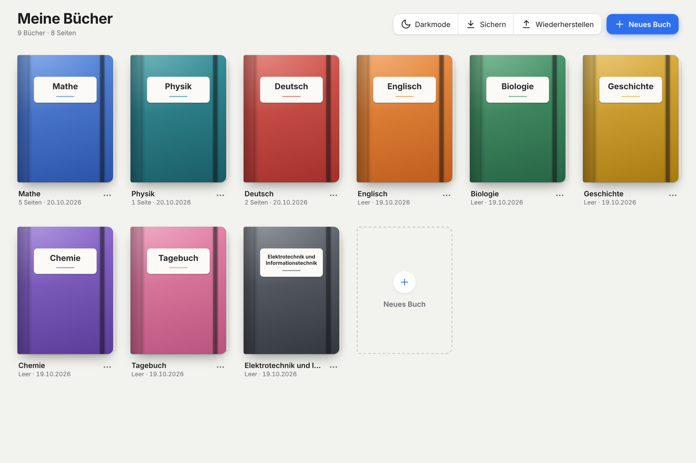

# Notizen

Handschrift-App im Stil von GoodNotes für das Surface Pro 11 (Windows ARM64, Surface Pen). Version 1.6.1.



Bücher mit Seiten, unendliche Arbeitsfläche oder Dokument aus Blättern DIN A4/A3 (hoch/quer), Stift, Textmarker, Radierer, Lasso, Formen und Pfeile, Graphen-Vorlagen (x/y, x/y/z), eigene Formen, Am Raster ausrichten, PDF-Import, PDF-Export, Darkmode, Sichern/Wiederherstellen. Bedienung: siehe [ANLEITUNG.md](ANLEITUNG.md).

## Aufbau
- `app.js` – das JavaScript der App (lesbare Quelle).
- `app.src.html` – HTML/CSS-Vorlage, in der `app.js` bereits eingefügt ist. Nach einer Änderung an `app.js` neu zusammensetzen:
  ```python
  s=open('app.js').read(); h=open('app.src.html').read(); i=h.index('<script>\n"use strict";')
  open('app.src.html','w').write(h[:i]+'<script>\n'+s+'</script>\n</body>\n</html>\n')
  ```
  (`app.js` beginnt mit `"use strict";`.) Die Platzhalter `@@PDFJS@@` und `@@PDFWORKER@@` nicht anfassen (beide stehen als Text in der Seite, pdf.js wird erst beim ersten PDF ausgeführt).
- `build.py` – baut `Notizen.html` und fügt pdf.js 3.11.174 aus `pdfjs/` ein. Die Datei läuft auch direkt im Browser.
- `Notizen-Browser.html` – die gebaute Datei (wie `Notizen.html`) für GitHub Pages: <https://mehmetmond.github.io/NoteApp/>. Dazu gehören `index.html` (leitet weiter), `sw.js` (Service Worker für den Offline-Start), `manifest.webmanifest` und `icon-180.png` (Home-Bildschirm, iPad). Der Service Worker läuft nur bei `http(s)://`, nicht im Windows-Programm.
- `electron/` – Windows-Hülle (Electron 38, electron-builder).
- `tests/` – Playwright-Tests (Chromium); Pfade in den Skripten ggf. anpassen.
- `tests/akku/` – Messen und Prüfen in der echten Windows-App (Python, siehe unten).
- `docs/` – Entwurfsnotizen für Version 1.4.

## Windows-Programm bauen
```sh
python3 build.py
mkdir -p electron/app && cp Notizen.html electron/app/index.html
cd electron && npm ci
npx electron-builder --win --arm64 --dir   # portabel: dist/win-arm64-unpacked
npx electron-builder --win --arm64         # Installer (unter Linux mit Wine)
```
Für x64 statt ARM `"arch": ["x64"]` im `win.target` von `electron/package.json` setzen.
Vor jeder Weitergabe `version` in `electron/package.json` erhöhen.

## Wichtig bei Änderungen
- Die Daten liegen in IndexedDB `notizen-app` (Version 4; Stores index, items, images, books, shapes) unter `%APPDATA%\Notizen`. Ein Upgrade darf nie bestehende Notizen löschen; die Version nur erhöhen.
- Das Sicherungsformat (3) muss alte Sicherungen weiter lesen können.
- Aussehen Windows XP: vorerst ausgeschaltet (`XP_ON = false` in `app.js`, das Skript im `<head>` setzt die Klasse nicht mehr, keine Umschalter); der Code bleibt. Alles unter `html.xp` (CSS-Block „Aussehen Windows XP“; die Klasse setzt schon ein kleines Skript im `<head>`, gespeichert als `theme`, Vorgabe XP). Titelleisten kommen aus `data-title`, ihr rotes ✕ wird per Klick auf die Ecke erkannt (`xpCloseHit`). Jedes Symbol hat zwei Gruppen: die Linienzeichnung (`display:var(--icm)`) und die bunte XP-Fassung (`display:var(--icx)`).
- Übersicht (`ov`): die ganze Seite einmal klein (höchstens 1536 px je Seite, `buildOverview` im Leerlauf, in Stücken); `draw()` legt sie unter die Kacheln, wo welche fehlen (`drawOverview`). Neue Striche am Ende von `S.items` werden nur dazugemalt, sonst nach 1,2 s Ruhe neu (`overviewCheck`); `closeNote` gibt sie frei. Test: `tests/overview.js`.
- Notizen an markierten Stellen (im Code „Erklärung“): die Markierung ist ein unsichtbarer Strich (`k: 'note'`, Inhalt `nt = { text, imgs, ink }`, `imgs` die ids der Bilder in ihrer Reihenfolge – bis 1.6.1 genau eines als `img`, gelesen wird beides mit `noteImgs` –, `ink` in Koordinaten der Schreibfläche der Karte): ein Rechteck 6 px um das Markierte; gezeichnet wird nur das „i“ in seiner oberen rechten Ecke (`drawNoteBadge`, 16 px auf dem Bildschirm, nie größer als der Kasten, liegt also in `bb`); das Markierte hängt mit `on` daran, `withGroups` nimmt beides in beide Richtungen mit. Die Bilder liegen im Store `images` (n = Seite), `closeNote` behält sie, beim Wiederherstellen als Kopie bekommt jedes (`nt.imgs`, ältere `nt.img`) eine neue id. Die Karte `#noteCard` übernimmt ihren Inhalt beim Schließen (`closeMenus` → `saveNoteCard`, leer = keine Erklärung) und beim Verlassen von Fenster oder App (`syncNoteCard`, Karte bleibt offen). Der Pfeil `#ncGrow` öffnet sie groß (`.glance`: fest in der Mitte, 85 % des Fensters, oben eine Leiste aus Bild, Text und Knöpfen, darunter die Schreibfläche über die ganze Breite, dahinter `#ncDim`; `setGlance` animiert von der Karte aus). Die Schreibfläche schreibt wie die Seite: Papier und Muster per `fillPattern`, Strich über `smoothStart`/`filterStep`/`pushFiltered`/`catchUp` mit Breite, Farbe und Deckkraft des Stifts, laufender Strich auf der schnellen Ebene `#ncLive` (desynchronized wie `cvLive`), Punkt beim Schweben `#ncDot`, Radierer-Ende (`penErase`) radiert ganze Striche. Werkzeuge der Schreibfläche (`ncTool`: pen, hl, tape, eraser; Knopf `#ncTools`, Auswahl `#ncPal`) mit Farben, Dicken und Tape-Mustern aus `S` (gemeinsam mit der Leiste); Striche in `ink` mit `hl`, Tape mit `tp`, `hid`, `id`, darauf Geschriebenes mit `on`. Die Schreibfläche zeigt `ink` mit dem Maßstab `ncInkS` (kleiner 1, wenn das Geschriebene größer ist als die Fläche); neue Punkte werden durch ihn geteilt. Test: `tests/notes.js`.
- Text auf der Seite: Element `{ t: 'x', x, y, w, h, ff, fs, c, al, runs: [{ s, b, i, u, k, c }] }` (`\n` trennt Zeilen). `textLayout` setzt ihn wie das Textfeld beim Schreiben (CSS `white-space: pre-wrap`, Zeilenhöhe 1,35, Grundlinie aus `fontBoundingBoxAscent/Descent`), `drawText` zeichnet ihn auf die Kacheln. Bearbeitet wird in `#txEd` (contenteditable über der Seite, `execCommand` für Fett usw., Enter = `insertLineBreak`, Einfügen nur als Text); `textRunsFrom` liest die Läufe aus den berechneten Stilen. Werkzeug `text` mit eigenem Knopf in der Leiste (Taste X). Die Leiste ist damit bei 1440 px (Surface) auf DIN-A4-Seiten genau voll: „PDF einfügen“ steht deshalb im Menü des Bild-Knopfs (`#mImgPdf`); ein weiterer Knopf in der Leiste kürzt dort den Titel (`tests/toolmenu.js` prüft das). Test: `tests/text.js`.
- Gefüllte Flächen in Strichen (Pfeilspitzen): `fl` = Liste von [erster, letzter] Punkt eines geschlossenen Umrisses; `buildPath` füllt sie (gleicher Umlaufsinn wie die übrigen Teile) und zeichnet ihre Kanten nicht nach.
- Formen: eigener Knopf `#bShape` (data-tool shape, zeigt die gewählte Form) und die Formenleiste `#shapeBar` (`placeShapeBar` aus `fitBar`: sichtbar, solange Formen gewählt ist, unter der Leiste links bündig mit `#colors`; `barBottom()` meint dann ihre Unterkante, Menüs öffnen darunter). Darin Grundformen und Koordinatensysteme (`[data-shape]`, `pickShape`), `#grOpen` (Einstellungen der Koordinatensysteme), `#sbCustom` (öffnet `#shapeMenu`, jetzt nur noch die eigenen Formen) und `#shStyle`. Lasso und Tape haben eigene Knöpfe (`#bLasso`, `#bTape`; die frühere Gruppe mit Auswahl ist weg). `markShapeMenu` markiert die gewählte Form überall.
- Grundformen tragen `sh = { a, b, rnd, sl, seed, m? }` (Ecken bzw. Enden, Stil, Startwert; `m` = Punkt, durch den eine Linie gebogen ist); ältere ohne `sh` bekommen es aus den Punkten (`shOf`). `reshape(it, o)` rechnet eine Form mit geändertem Stil (`ds`, `rnd`, `sl`, `fs`), Farbe (`c`), Dicke (`w`) oder Knick (`m`) neu, gleiche id; `transformItem` verschiebt `sh` mit. Nach `finishShape` bleibt die neue Form ausgewählt (`setSel`, `S.sel.auto`; nur im Formen-Werkzeug, ohne Auswahlleiste, ein Werkzeugwechsel hebt sie auf; `refreshSel` und `stepHistory` behalten `auto`); `restyleSel` wendet Stil, Füllung, Farbe und Dicke darauf an (Formenleiste, `renderColors`, `renderSizes`, eigene Farbe), je ein Schritt. Im Formen-Werkzeug wirkt an ihr nur der Punkt zum Biegen (kein Griff zum Skalieren, damit die nächste Form an ihrer Ecke beginnen kann), sonst entsteht eine neue Form; eine selbst getroffene Auswahl (ohne `auto`) verschiebt der Stift dort wie bisher (Lasso). Rückgängig/Wiederholen (`stepHistory`) behält die Auswahl, soweit es sie noch gibt.
- Füllung (`fs: 'hachure' | 'cross' | 'solid'`, nur `SHAPE_FILL`): `fillShape` zeichnet sie in `drawItem` (über `shapeDraw`) unter die Kontur; Fläche = Punkte der Form (`fillGeo`, nonzero), voll mit `FILL_A`, Schraffur als dünne Linien „/“ (und „\\“), auf die Fläche beschnitten. Lasso-Tipp innen trifft gefüllte Formen (`hitCtx.isPointInPath`).
- Biegen: `lineXY(k, A, B, M, …)` — ohne `M` genau wie beim Zeichnen, mit `M` `bentLine` (quadratische Kurve durch `M` bei t = 0,5, Spitzen über `headPts` in Richtung der Kurve, Schaft bis zur Kerbe; von Hand `roughShaft`). Punkte an `editTarget()` (genau eine Grundform ausgewählt): Linien `lineHandleAt` ('a' Anfang, 'b' Ende/Spitze, 'm' Mitte = `bendPoint`), Kastenformen `boxHandles`/`boxHandleAt` ('left', 'right', 'top', 'bottom': nur Breite bzw. Höhe, `reshape` mit neuen `a`/`b`; die Griffe sitzen etwas außerhalb, `boxGrips`: Strichbreite/2 + 10 px, an der Kante selbst wird verschoben); ziehen = Aktion `'bend'` mit `part` (`beginBend`, `moveBend`, Vorschau auf der Live-Ebene, die Form ist dabei in den Kacheln versteckt), Mitte zurück = gerade, Enden und Seiten rasten mit Raster ein.
- Tapes immer oben: `tapeInfo` ordnet Bilder, Textmarker, Übriges, dann jedes Tape mit dem, was darauf steht (`on`, nur wenn `on` ein Tape meint – sonst eine Erklärung); `drawNoteInk` ebenso. `commitLive` kopiert einen neuen Strich unter einem Tape nicht von der Live-Ebene, die Kacheln werden neu gezeichnet.
- Textmarker: `solidPath` setzt bei `hl` statt runder Enden `flatEnds` (gerade, etwas überstehend); beim Zeichnen kommt er Stück für Stück auf die Live-Ebene wie der Stift (`hlLive`, Teile aus `joinPiece` wie im fertigen Strich), nur die flache Spitze wandert mit: ihr Kasten wird geleert und mit den Stücken darin neu gefüllt. Ein Bild kostet so gleich viel, egal wie lang der Strich ist (Seite und Notiz).
- Notiz: Tape, Textmarker und gerade Striche zeichnet `inkRedraw` höchstens einmal pro Bild (`requestAnimationFrame`); `drawTape` lässt beim Ziehen (`live`) den Schatten weg. `drawSizePreview` schickt eine Schreibprobe (vier Schlaufen, leichtes Zittern, 4 ms je Punkt) durch die Glättung. Test: `tests/marker.js`.
- Tape-Blase `#tapeMenu` (`showTapeMenu` aus `toggleTapeAt`): Schalter `#tmCover` (`setTapes` für genau dieses Tape), `#tmDel` (entfernt das Tape mit dem, was darauf steht, ein Schritt), Farben `#tmColors` (`recolorTape`) und Muster `#tmPats` (`repatternTape`, Figuren mit ihrer Farbe). Ein Tipp auf die Seite schließt sie, ohne verschluckt zu werden (`hideTapeMenu` vor der Prüfung auf offene Menüs); Werkzeugwechsel und `setView` schließen sie auch. Test: `tests/tape.js`.
- Tape-Muster in Menüs: `tapeSwatch(p, W, H, sel, col)` zeichnet mit Luft ringsum; gewählt mit einem Umriss in `--accent` (Silhouette in 16 Richtungen versetzt, ohne Schatten: `drawTape(..., flat)`).
- Textmarker (seit 1.6.1): `buildPath` gibt für `hl` die Mittellinie (`hlGeo`: erstes und letztes Stück bis w/2 gerade, dazwischen quadratische Bögen durch die Mitten), gemalt mit `paintPath` als Strich (Breite w, `butt`, `round`): flache Enden genau an den Punkten. Textmarker gleicher Deckkraft (`alKey`) kommen als eine Schicht auf die Fläche (`paintHl`: deckend auf eine Hilfsfläche, einmal mit Deckkraft, hell multipliziert), überall wo gemalt wird (`paintItems`: Kacheln, Auswahl, Export, Notiz). Beim Ziehen `hlLive`: nur der Bereich ab dem Punkt vor dem geraden Ende wird geleert und mit dem ganzen Strich neu gemalt, beschnitten; ausgespart (`cut`, `hlCutPage`/`hlCutInk`) werden Textmarker gleicher Deckkraft und alles darüber.
- Loslassen ohne ganze Kacheln (`commitLive`): neues Tape `paintOnTop` (liegt über allem), Textmarker `repaintStrips` (Streifen ≤ 64 px entlang der Striche, `stripRects`; bei Füllung der Kasten; je Kachel ein Durchgang über `paintTile(t, i, j, clips)`, das auch `renderTile` nutzt). Striche und Formen kommen wie früher aus der Live-Ebene; kreuzen sie ein Tape, wird nur der Schnitt der Streifen mit dem Tape neu gemalt (`repaintStrips(list, within)`), damit das Tape oben bleibt. Mit Ausschnitt rechnet der Browser die Kantenglättung an einzelnen Pixeln minimal anders (`tests/repaint.js` erlaubt das). Tape beim Ziehen: `tapeLive` malt nur das Ende neu (Figuren nur im Ausschnitt gestempelt, `drawTape(…, box)`), `tapTiny`: erst nach mehr als einem Antippen.
- Seit 1.6.2: Notiz-Schreibfläche mit Zoom (`ncView` {z, x, y} über dem Grundmaßstab `ncInkS`, `ncS()`; zwei Finger in eigenen Listenern in der Capture-Phase, `ncZoomAt`, `requestNcDraw`, Knopf `#ncZoom`); Striche merken sich Maßstab und Verschiebung (`d.s`, `d.o`). `dropOrphanNotes` in `commit`: verliert eine Erklärung mit einer Änderung das Letzte, was sie markiert (`on`), geht sie mit. Werkzeugwechsel: `fitBar` misst nur bei Größe/Name/Öffnen (`barGeo`), `placeShapeBar` nutzt das, `sizeStrip` aus `stripCache`, `popIn`/`popOut` merken ihre Animationen (`popAnims`, kein `getAnimations`), Fokus nach dem Klick im nächsten Bild weg. Speichern: angehängte Striche ohne Vergleich (`S.savedList`), nicht während einer Aktion (`saveSoon`). Lasso: `polyTester` (Kanten in Streifen) und Mehrheit entschieden. Auswahl: `selFacts` je Auswahl und Stand. Radierer: Kasten zuerst (`boxNear`), Lücken zwischen Abtastungen gefüllt, Streifen statt ganzer Kacheln. `setItems` malt Geändertes über `repaintItems` als Streifen (Rückgängig, Verschieben, Biegen …; sehr viel in einer Kachel oder Erklärungen: ganze Kachel). `draw()` rastert mitten im Zoomen keine Kacheln der alten Stufe, solange die Übersicht stimmt. `openNote` wartet höchstens 150 ms auf die kleinen Fassungen sichtbarer Bilder und lädt nötige volle Fassungen gleich mit. Teil-Leeren mit `wipe()` (destination-out) statt `clearRect`. Mehrere Bilder je Notiz (`nt.imgs`): `addNoteImages` hängt an (Datei mit `multiple`, Zwischenablage, Strg + V, `drop` auf `#noteCard`), `showNoteImgs` baut die Reihe `#ncImgBox` (`.ncim` je Bild, `.many` ab zwei, `ncCur.pics`: Datensatz, Element, Object-URL); die Größe kommt vor dem Laden aus `--r`/`--w` (Seitenverhältnis, Breite), klein zeigt `low`, groß (`.big`, einrasten, das angetippte in der Mitte) die volle Fassung. Öffnen und Schließen einer älteren Erklärung ist kein Schritt (`orig` wie `syncNoteCard` schreibt). Test: `tests/noteimgs.js`.
- Stil nachträglich: `#shapePop` neben einer Lasso-Auswahl, die nur aus Grundformen besteht (`popShapes`: nicht `auto`, nicht im Formen-Werkzeug, alle `restylable`); die Zeilen sind Kopien der Gruppen von `#shStyle`, `restyleSel(o, true)` ändert nur die Auswahl. `placeShapePop` läuft aus `placeSelbar` (rechts neben der Auswahl, sonst links; unten bündig, wenn die Auswahlleiste darunter liegt), Zeilen nur, wenn sie passen (`SP_FITS`), markiert ist der gemeinsame Wert (`SP_VAL`).
- Dicken von Textmarker und Tape: `sizeStrip(k, v)` statt Punkt (Knöpfe `.sz.strip`, 40 px: 4 × 40 = die 160 px von `#sizes`, keine Lücke vor `#bTune`); Tape über `tapeSwatch` im gewählten Muster, Textmarker als Schwung (Bézier, echter Pfad mit flachen Enden, Ränder und Enden etwas kräftiger). `renderColors` ruft `renderSizes` (Farbe, Hell/Dunkel), ebenso Musterwahl und Deckkraft.
- Stil der Grundformen (`S.shapeStyle = { ds, rnd, sl, fs }`, gespeichert als `shapeStyle`, Umschalter `#shStyle` in der Formenleiste): Die Kontur steht am Strich (`ds: 'dash' | 'dot'`, fehlt bei durchgezogen) und entsteht erst beim Zeichnen: `buildPath(..., ds)` → `dashPath` zerlegt die Linie (Flächen `fl` bleiben voll); Längen aus der Strichbreite, gestreckt, bis das Muster aufgeht (genaue Vielecke je Kante, sonst über den ganzen Zug). Rund und von Hand sind in die Punkte gerechnet (`styledLines` in `shapeGeo`: `roundCorners`, dann `roughEdges` / `roughSmooth` / `roughArrow` mit `seeded(a.seed)`, Startwert je Form). Graphen und eigene Formen bekommen keinen Stil; `ds` geht mit in eigene Formen und deren Sicherung (`shapeFromBackup` prüft ihn). Vorschaubilder (`o.cheap`) nehmen `setLineDash`. Test: `tests/shapestyle.js`.
- Striche liegen in Weltkoordinaten, Ansicht {tx, ty, z}, gezeichnet wird in Kacheln zu 512 px.
- Akku: `cvMain` ist an jeder Seite um einen Rand (`PADD`) größer als der Bildschirm; beim Verschieben schiebt der Compositor sie (`transform`), neu gemalt wird erst, wenn der Rand nicht reicht. Bildschirm-Koordinaten der Kacheln liefert `tileRange`, Leinwand-Koordinaten `mainRange`.
- Akku: wer auf `ctxLive` zeichnet, meldet den Bereich mit `liveMark`/`liveMarkDev`; `liveClear` leert nur diesen Bereich (Leeren kostet auf dem Surface Grafikzeit je Fläche, `clearRect` auf einem Teil so viel wie auf allem). Leer und ohne schwebenden Stift ist die Live-Ebene ausgeblendet (`liveVis`). `tests/akku/test_live.py` prüft nach jedem Leeren, dass nichts übrig bleibt.
- Cornell-Vorlage: `paper.t = 'cornell'` (nur DIN A4 hoch, im Dialog die vierte Karte). `cornellOf(k)` liefert Kopf-, Zusammenfassungs- und Spaltenlinie (auf dem Raster des Felds), `drawCornell` zeichnet sie samt Beschriftung in `fillBg` und im Export (`renderTo`). `S.cornellHide` (pro geöffneter Seite, nicht gespeichert) zeichnet die Notizen-Spalte auf den Kacheln noch einmal mit `ctx.filter = blur(…)`; Knopf `#cornBtn` (`placeCornellBtn` bei jeder Ansicht). Test: `tests/cornell.js`.
- Seitenformat im Index-Eintrag: `paper: { f: 'a4' | 'a3', o: 'p' | 'l', n }`, ohne `paper` ist die Fläche unendlich. `n` Blätter liegen untereinander, das erste bei (0, 0), Abstand 40; 1 Welteinheit = 1/96 Zoll (A4 hoch = 793,7 × 1122,5). Das Raster (Muster, Am Raster ausrichten) beginnt auf Blättern am inneren Rand jedes Felds (`fieldsOf`), sonst bei 0.

## Akku messen (`tests/akku/`)
In der echten App, mit leerem Testprofil (eigene Notizen bleiben unberührt). Python 3 mit `pip install websocket-client pillow`.
```sh
python -X utf8 tests/akku/mkapp.py . <installierte App> <Ziel>     # neue Version als startbare Kopie (app.asar wie electron-builder)
python tests/akku/measure.py <Notizen.exe> <Profilordner> alt.json   # CPU-/GPU-Zeit je Ablauf
python tests/akku/cmp_runs.py alt.json neu.json                     # Vergleich (beide Läufe direkt nacheinander)
python tests/akku/test_live.py <Notizen.exe> <Profilordner>          # Live-Ebene: leer nach jedem Leeren, ein-/ausgeblendet
python tests/akku/test_screen.py <Notizen.exe> <Profilordner> <Ordner>   # Bildschirmfotos; cmp_shots.py alt neu vergleicht pixelgenau
python tests/akku/test_pdf.py <Notizen.exe> <Profilordner>           # PDF-Import mit nachgeladenem pdf.js
```
`gpu_kosten.py` und `verschieben.py` sind die Versuche, mit denen die Akkufresser gefunden wurden (GPU-Zeit je Bild).
