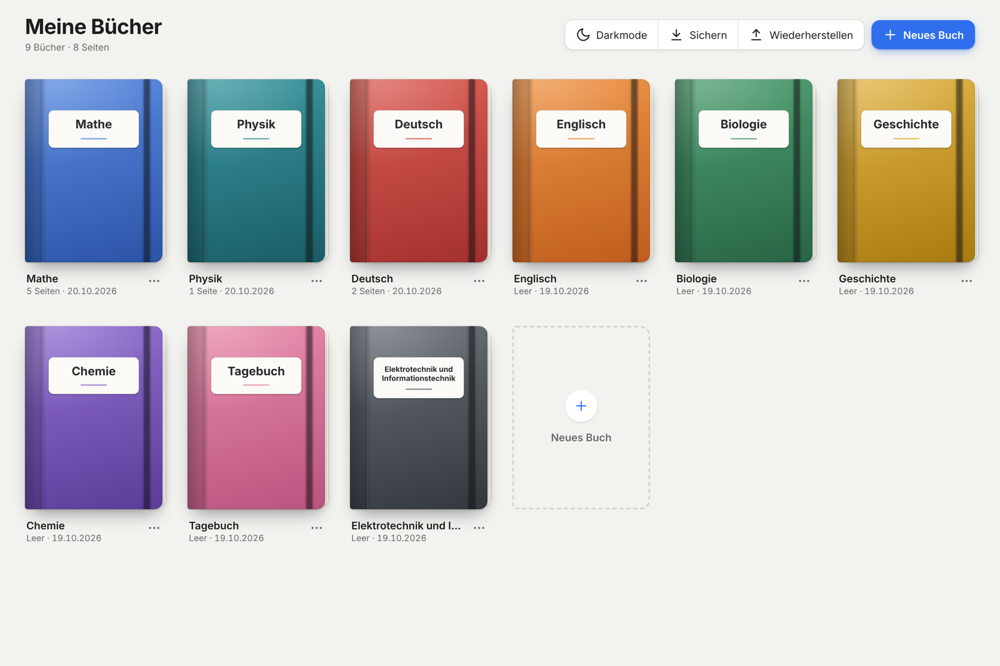

# Notizen

Handschrift-App im Stil von GoodNotes für das Surface Pro 11 (Windows ARM64, Surface Pen). Version 1.4.0.



Bücher mit Seiten, unendliche Arbeitsfläche, Stift, Textmarker, Radierer, Lasso, Formen und Pfeile, Graphen-Vorlagen (x/y, x/y/z), eigene Formen, Am Raster ausrichten, PDF-Import, Darkmode, Sichern/Wiederherstellen. Bedienung: siehe [ANLEITUNG.md](ANLEITUNG.md).

## Fertiges Windows-Programm herunterladen
Im Ordner [`windows/`](windows) gibt es zwei Ausführungen:
- **arm64** für Windows-Geräte mit ARM-Prozessor (z. B. Surface Pro 11 mit Snapdragon).
- **x64** für normale Windows-PCs und Laptops mit Intel- oder AMD-Prozessor.

Welche du brauchst, steht unter Einstellungen › System › Info › Systemtyp („ARM-basierter Prozessor“ = arm64, „x64-basierter Prozessor“ = x64).

- **Ohne Installation (empfohlen):** die beiden Dateien `Notizen-1.4.0-<arm64 oder x64>-ohne-Installation.zip.teil0` und `.teil1` sowie `zusammenfuegen.bat` herunterladen, alle in denselben Ordner legen und `zusammenfuegen.bat` doppelklicken. Daraus entsteht die normale Zip. Entpacken und `Notizen\Notizen.exe` starten. (Aufgeteilt, weil GitHub einzelne Dateien über 100 MB ablehnt.)
- **Mit Installer:** `Notizen-1.4.0-arm64.zip` bzw. `Notizen-1.4.0-x64.zip` herunterladen, entpacken und die Setup-Datei starten.

**Ohne Windows (Mac, Linux, Tablet):** [`Notizen-Browser.html`](Notizen-Browser.html) herunterladen und im Browser öffnen.

Für das x64-Programm beim Bauen `npx electron-builder --win --x64` mit `"arch": ["x64"]` im `win.target` verwenden.

## Aufbau
- `app.js` – das JavaScript der App (lesbare Quelle).
- `app.src.html` – HTML/CSS-Vorlage, in der `app.js` bereits eingefügt ist. Nach einer Änderung an `app.js` neu zusammensetzen:
  ```python
  s=open('app.js').read(); h=open('app.src.html').read(); i=h.index('<script>\n"use strict";')
  open('app.src.html','w').write(h[:i]+'<script>\n'+s+'</script>\n</body>\n</html>\n')
  ```
  (`app.js` beginnt mit `"use strict";`.) Die Platzhalter `@@PDFJS@@` und `@@PDFWORKER@@` nicht anfassen.
- `build.py` – baut `Notizen.html` und fügt pdf.js 3.11.174 aus `pdfjs/` ein. Die Datei läuft auch direkt im Browser.
- `electron/` – Windows-Hülle (Electron 38, electron-builder).
- `tests/` – Playwright-Tests (Chromium); Pfade in den Skripten ggf. anpassen.
- `docs/` – Entwurfsnotizen für Version 1.4.

## Windows-Programm bauen
```sh
python3 build.py
mkdir -p electron/app && cp Notizen.html electron/app/index.html
cd electron && npm ci
npx electron-builder --win --arm64 --dir   # portabel: dist/win-arm64-unpacked
npx electron-builder --win --arm64         # Installer (unter Linux mit Wine)
```
Vor jeder Weitergabe `version` in `electron/package.json` erhöhen.

## Wichtig bei Änderungen
- Die Daten liegen in IndexedDB `notizen-app` (Version 4; Stores index, items, images, books, shapes) unter `%APPDATA%\Notizen`. Ein Upgrade darf nie bestehende Notizen löschen; die Version nur erhöhen.
- Das Sicherungsformat (3) muss alte Sicherungen weiter lesen können.
- Striche liegen in Weltkoordinaten, Ansicht {tx, ty, z}, gezeichnet wird in Kacheln zu 512 px.
